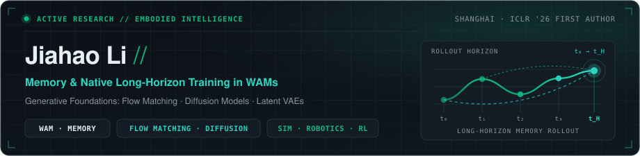
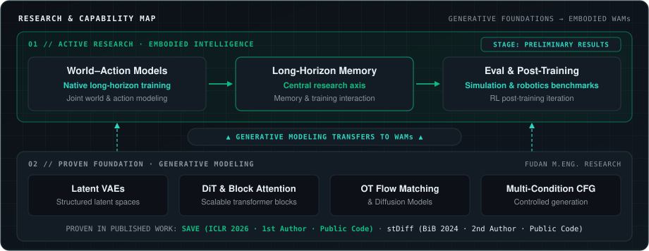
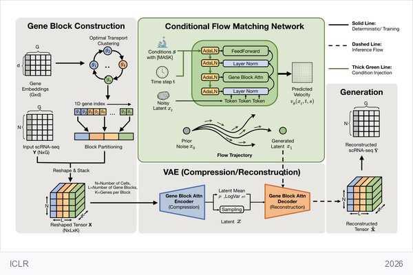
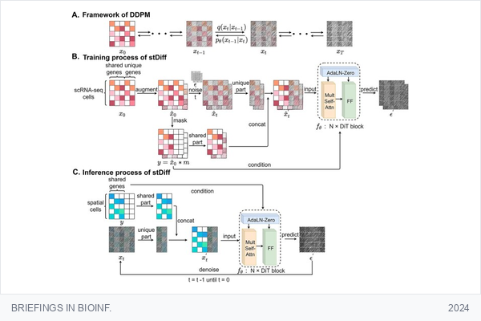

<div align="center">

<picture>
  <source media="(prefers-color-scheme: dark)" srcset="./assets/hero-dark.svg" />
  <source media="(prefers-color-scheme: light)" srcset="./assets/hero-light.svg" />
  
</picture>

<br/><br/>

<a href="https://l1jiahao.github.io/"></a>
<a href="https://l1jiahao.github.io/publications"></a>
<a href="https://arxiv.org/abs/2604.16776"></a>
<a href="https://x.com/argonx12"></a>
<a href="mailto:argonli.ai@gmail.com"></a>

</div>

<br/>

```console
li@embodied:~$ whoami
Jiahao Li — Embodied AI Researcher · M.Eng. Fudan University (2023–2026)

li@embodied:~$ cat research.focus
active/        World–Action Models (WAMs) · native long-horizon training · memory
eval/          simulation & robotics benchmarks · RL post-training
foundation/    OT flow matching · diffusion models · latent VAEs · DiT · CFG
stage/         implementation -> experiments -> preliminary results
```

## Research & Capability Map

<div align="center">

<picture>
  <source media="(prefers-color-scheme: dark)" srcset="./assets/research-map-dark.svg" />
  <source media="(prefers-color-scheme: light)" srcset="./assets/research-map-light.svg" />
  
</picture>

</div>

## Selected Work

<table>
  <tr>
    <td width="240" align="center" valign="middle">
      <a href="https://openreview.net/forum?id=l7QEoK4uDP">
        
      </a>
    </td>
    <td valign="top">
      <strong>SAVE: Multi-Condition Generation with Gene Block Attention</strong><br/>
      <br/><br/>
      <code>Latent VAE</code> <code>DiT</code> <code>OT Flow Matching</code> <code>Multi-Condition CFG</code><br/><br/>
      Latent VAE and DiT-based optimal-transport flow matching with block-structured attention and multi-condition CFG. Public code covers semantic block construction, conditional generation, distribution evaluation, and perturbation prediction.<br/><br/>
      <a href="https://openreview.net/forum?id=l7QEoK4uDP"></a>
      <a href="https://arxiv.org/abs/2604.16776"></a>
      <a href="https://github.com/fdu-wangfeilab/sc-save"></a>
    </td>
  </tr>
  <tr>
    <td width="240" align="center" valign="middle">
      <a href="https://doi.org/10.1093/bib/bbae171">
        
      </a>
    </td>
    <td valign="top">
      <strong>stDiff: Diffusion Imputation for Spatial Transcriptomics</strong><br/>
      <br/><br/>
      <code>Conditional Diffusion</code> <code>Spatial Modeling</code><br/><br/>
      Conditional diffusion model imputing spatial transcriptomics from single-cell reference distributions.<br/><br/>
      <a href="https://doi.org/10.1093/bib/bbae171"></a>
      <a href="https://github.com/fdu-wangfeilab/stDiff"></a>
      <a href="https://l1jiahao.github.io/publications"></a>
    </td>
  </tr>
</table>

## Technical Stack

| Domain | Focus & Tools |
| :--- | :--- |
| **Embodied AI & WAM** |      |
| **Generative Modeling** |      |
| **Core Engineering** |     |

## Activity

<div align="center">

<picture>
  <source media="(prefers-color-scheme: dark)" srcset="https://raw.githubusercontent.com/l1jiahao/l1jiahao/output/snake-dark.svg" />
  <source media="(prefers-color-scheme: light)" srcset="https://raw.githubusercontent.com/l1jiahao/l1jiahao/output/snake-light.svg" />
  
</picture>

<br/>

<sub>
  <strong>M.Eng.</strong> Fudan University (2023–2026) · <strong>B.Eng.</strong> Nanchang University (2019–2023) ·
  <a href="https://l1jiahao.github.io/#research">Research Overview</a> ·
  <a href="mailto:argonli.ai@gmail.com?subject=WAM%20research">Discuss WAM Research</a>
</sub>

</div>
